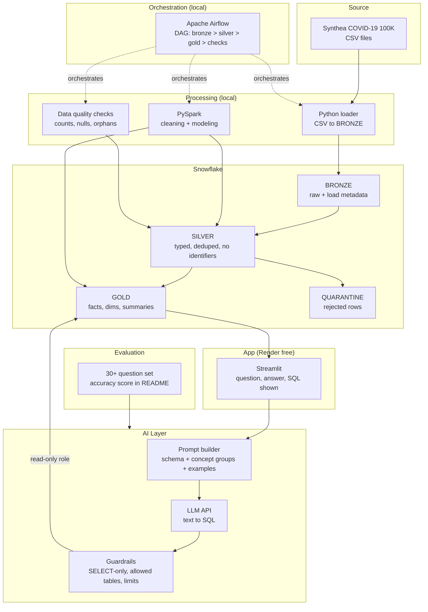
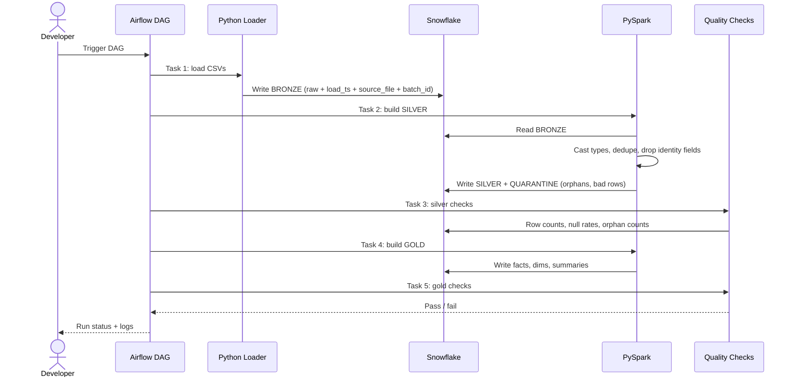
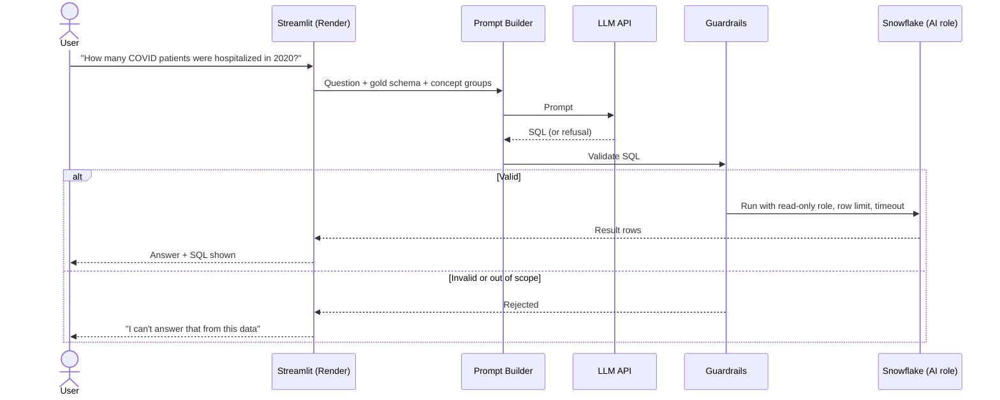
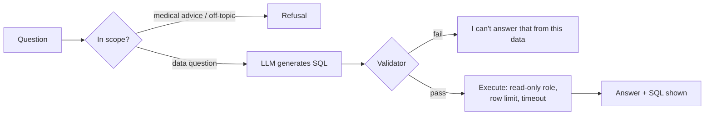
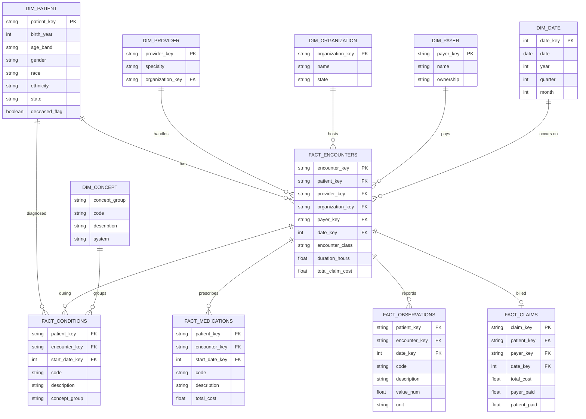

# Synthea COVID-19 Analytics — Design & Architecture

> Batch data platform on the Synthea COVID-19 100K synthetic dataset. Medallion pipeline (Snowflake + PySpark + Airflow) with a guarded AI text-to-SQL assistant on top.

**Data is synthetic.** Every result reflects Synthea's COVID module assumptions, not real epidemiology. The UI and README must say so, and the assistant must never give medical advice.

---

## 1. High-Level Architecture



---

## 2. Data Flow

### 2.1 Pipeline run (batch, local)



### 2.2 Question flow (live, via the app)



---

## 3. Directory Structure

```
covid19-analytics/
├── data/                          # Gitignored. Raw CSVs live here locally
│   └── README.md                  # Where to download the dataset
│
├── pipeline/
│   ├── loaders/
│   │   └── bronze_loader.py       # CSV -> Snowflake BRONZE
│   ├── spark/
│   │   ├── silver/                # One module per source table
│   │   │   ├── patients.py
│   │   │   ├── encounters.py
│   │   │   ├── conditions.py
│   │   │   └── ...
│   │   ├── gold/
│   │   │   ├── dims.py
│   │   │   ├── facts.py
│   │   │   └── summaries.py
│   │   └── common.py              # Spark session, Snowflake connector config
│   ├── quality/
│   │   └── checks.py              # Counts, nulls, orphans, uniqueness
│   └── concepts/
│       └── concept_groups.csv     # Maps condition codes to groups (diabetes, etc.)
│
├── airflow/
│   ├── dags/
│   │   └── covid_pipeline.py      # bronze > silver > gold > checks
│   └── Dockerfile
│
├── ai/
│   ├── prompt_builder.py          # Schema + concept groups + examples
│   ├── llm_client.py              # LLM API wrapper
│   ├── guardrails.py              # SQL validation
│   └── refusals.py                # Medical advice, out-of-scope rules
│
├── app/
│   └── streamlit_app.py           # Question box, answer, SQL shown
│
├── evaluation/
│   ├── questions.yaml             # 30+ questions with expected SQL / answers
│   └── run_eval.py                # Scores accuracy, writes report
│
├── sql/
│   ├── 00_roles_and_schemas.sql   # Roles, schemas, warehouse, resource monitor
│   ├── 10_bronze_ddl.sql
│   ├── 20_silver_ddl.sql
│   └── 30_gold_ddl.sql
│
├── tests/
├── docker-compose.yml             # Airflow + Spark (local)
├── .github/workflows/             # CI: tests + eval
├── .env.example
└── README.md
```

---

## 4. Tech Stack Reference

### Layer 1 — Source & Ingestion

| Tech | Role | Notes |
|------|------|-------|
| **Synthea COVID-19 100K (CSV)** | Source dataset | 100K synthetic patients. Confirm file list and columns after unzipping |
| **Python** | Loader and glue | Reads CSVs, writes BRONZE with load metadata |
| **Snowflake connector / COPY INTO** | Bulk load | Prefer staged files over row-by-row inserts |

### Layer 2 — Warehouse

| Tech | Role | Notes |
|------|------|-------|
| **Snowflake** ✓ | BRONZE / SILVER / GOLD, roles, SQL serving | Trial account. XS warehouse, auto-suspend 60s, resource monitor |
| **Snowflake roles** | Access control | Pipeline role writes. AI role is read-only on GOLD |

### Layer 3 — Processing

| Tech | Role | Notes |
|------|------|-------|
| **PySpark** ✓ | Silver cleaning, gold modeling | Local in Docker. Justified by multi-million-row tables |
| **Spark-Snowflake connector** | Read/write between Spark and Snowflake | Check Spark / connector / JDBC version compatibility first |
| **Snowflake SQL** | Optional share of silver/gold work | Use if laptop memory is tight |

### Layer 4 — Orchestration & Quality

| Tech | Role | Notes |
|------|------|-------|
| **Apache Airflow** ✓ | DAG scheduling, retries, logs | Local via Astro CLI or Docker Compose. Not deployed to a server |
| **PySpark checks** | Row counts, null rates, orphan counts | Results written to a checks table |
| **Great Expectations** | Optional upgrade to quality checks | Add after the pipeline works |

### Layer 5 — AI Layer

| Tech | Role | Notes |
|------|------|-------|
| **LLM API (Claude)** | Question to SQL | Returns SQL only, or a refusal |
| **Prompt builder** | Injects gold schema, concept groups, example pairs | Single biggest accuracy lever |
| **Guardrail module** | Validates SQL before execution | See Section 6 |
| **Evaluation harness** | Scores 30+ questions | Accuracy reported in README |

### Layer 6 — App & Deployment

| Tech | Role | Notes |
|------|------|-------|
| **Streamlit** | UI: question, answer, SQL shown | Alt: FastAPI + frontend later |
| **Render (free)** | Hosts the app only | 512 MB RAM, sleeps when idle, cold start about a minute. Verify current limits |
| **GitHub + Actions** | Repo, tests, evaluation runs | |
| **Docker** | Local Airflow and Spark | Allow 6–8 GB RAM |

### Deliberately excluded

| Tech | Why not |
|------|---------|
| **Kafka** | Static dataset, no streaming problem to solve |
| **dbt** | PySpark already covers transformation. Two tools blur the story |
| **Cloud object storage** | Local files load straight into Snowflake |
| **Databricks** | Would replace Snowflake + PySpark + Airflow rather than add to them |

---

## 5. Data Model

> Table and column lists below follow the standard Synthea CSV export. **Confirm against the actual files before writing DDL.** The COVID-19 100K set may not include every table.

### 5.1 Bronze (raw, as delivered)

One table per source file, all columns kept as strings, plus metadata:

```sql
-- Source tables (confirm after unzip)
bronze.patients, bronze.encounters, bronze.conditions,
bronze.medications, bronze.observations, bronze.procedures,
bronze.immunizations, bronze.careplans, bronze.claims,
bronze.payers, bronze.providers, bronze.organizations ...

-- Metadata added to every bronze table
_load_ts        TIMESTAMP,   -- when loaded
_source_file    STRING,      -- originating CSV
_batch_id       STRING       -- pipeline run id
```

### 5.2 Silver (clean, typed, safe)

- Cast dates and numerics, standardize nulls
- Deduplicate on primary keys
- **Drop identity fields** (names, SSN, driver's license, passport, address) so nothing downstream, including the AI, can see them
- Enforce referential integrity: orphan rows go to quarantine

```sql
quarantine.rejected_rows (
  id, source_table, row_payload VARIANT,
  reason STRING,             -- orphan_patient | bad_date | duplicate_key ...
  batch_id, rejected_at
)

pipeline.quality_checks (
  id, batch_id, layer, table_name,
  check_name, result STRING, value NUMBER, checked_at
)
```

### 5.3 Gold (analytics-ready)

```sql
-- Dimensions
dim_patient   (patient_key, birth_year, age_band, gender, race, ethnicity, state, deceased_flag)
dim_provider  (provider_key, specialty, organization_key)
dim_organization (organization_key, name, state)
dim_payer     (payer_key, name, ownership)
dim_date      (date_key, date, year, quarter, month, week, day_of_week)
dim_concept   (concept_group, code, description, system)   -- e.g. diabetes, hypertension, obesity

-- Facts
fact_encounters   (encounter_key, patient_key, provider_key, organization_key, payer_key,
                   date_key, encounter_class, duration_hours, base_cost, total_claim_cost)
fact_conditions   (patient_key, encounter_key, start_date_key, stop_date_key, code, description, concept_group)
fact_medications  (patient_key, encounter_key, start_date_key, code, description, total_cost)
fact_observations (patient_key, encounter_key, date_key, code, description, value_num, value_text, unit)
fact_claims       (claim_key, patient_key, payer_key, date_key, total_cost, payer_paid, patient_paid)

-- Summaries
agg_covid_severity   (severity, patient_count, pct_of_covid)
agg_covid_by_month   (year_month, cases, hospitalized, icu, deaths)
agg_comorbidity      (concept_group, covid_patients, hospitalized_pct, mortality_pct)
agg_cost_by_payer    (payer_key, severity, avg_claim_cost, patient_count)
```

**Severity definition** (hospitalized, ICU, ventilated, deceased) must be derived from encounter classes, procedures and conditions that actually exist in the data. Write the rule down in `concepts/` and test it before building summaries.

---

## 6. AI-SQL Layer Design

The assistant never gets data access of its own. It gets a schema description and produces SQL, and the guardrails decide whether that SQL may run.



### 6.1 Guardrail rules

| Rule | Purpose |
|------|---------|
| Single statement, `SELECT` only | No writes, no multi-statement tricks |
| Allowed tables: `GOLD` schema only | No bronze, silver or quarantine access |
| Blocked columns / patterns | Nothing identifying, ever |
| Row limit and query timeout | Cost and abuse control |
| Read-only Snowflake role | Enforcement at the database, not just in code |
| Medical-advice refusal | "What should I take for…" is declined |
| "I don't have that" path | Questions the data cannot support |
| Daily request cap in the app | Protects LLM and Snowflake spend |

### 6.2 Validator sketch

```python
# ai/guardrails.py
import re
import sqlglot
from sqlglot import exp

ALLOWED_SCHEMA = "GOLD"
MAX_ROWS = 1000

class SqlRejected(Exception):
    pass

def validate(sql: str, allowed_tables: set[str]) -> str:
    statements = sqlglot.parse(sql, read="snowflake")
    if len(statements) != 1:
        raise SqlRejected("Exactly one statement allowed")

    tree = statements[0]
    if not isinstance(tree, exp.Select):
        raise SqlRejected("Only SELECT is allowed")

    for table in tree.find_all(exp.Table):
        name = table.name.upper()
        schema = (table.db or ALLOWED_SCHEMA).upper()
        if schema != ALLOWED_SCHEMA or name not in allowed_tables:
            raise SqlRejected(f"Table not allowed: {schema}.{name}")

    if not tree.args.get("limit"):
        tree = tree.limit(MAX_ROWS)

    return tree.sql(dialect="snowflake")
```

The Snowflake role is the real safety net. Treat this code as a second layer.

### 6.3 Prompt contents

1. Gold table and column descriptions (generated from DDL comments)
2. Concept-group definitions ("diabetes" means these codes)
3. Severity definitions
4. 8–10 example question → SQL pairs
5. Output contract: SQL only, or the literal refusal token

---

## 7. Phased Implementation Plan

### Phase 1 — Foundation (Week 1)
**Goal:** Environment, data and warehouse ready

- [ ] Init repo, folder structure, `.env.example`, `.gitignore` for `data/`
- [ ] Download and unzip the dataset. Record file list, columns, row counts
- [ ] Snowflake trial: warehouse (XS, auto-suspend 60s), resource monitor
- [ ] `00_roles_and_schemas.sql`: BRONZE, SILVER, GOLD, QUARANTINE, PIPELINE schemas
- [ ] Roles: `PIPELINE_ROLE` (write), `AI_ROLE` (read-only on GOLD)
- [ ] Docker setup: Spark and Airflow starting locally
- [ ] Verify Spark–Snowflake connector versions with a hello-world read/write
- [ ] **Deploy a hello-world Streamlit app to Render**

**Deliverable:** Empty schemas exist, Spark talks to Snowflake, a live Render URL responds.

---

### Phase 2 — Bronze (Week 2)
**Goal:** Raw data in Snowflake, traceable

- [ ] `10_bronze_ddl.sql` from the real column list
- [ ] Loader: stage files, `COPY INTO`, add `_load_ts`, `_source_file`, `_batch_id`
- [ ] Row-count reconciliation: file rows = bronze rows
- [ ] Idempotent reruns (same batch does not double-load)

**Deliverable:** All source tables in BRONZE with matching row counts.

---

### Phase 3 — Silver (Week 3–4)
**Goal:** Clean, safe, trusted data

- [ ] Type casting and null standardization per table
- [ ] Deduplication on primary keys
- [ ] Drop identity columns
- [ ] Referential checks: orphans to `quarantine.rejected_rows`
- [ ] `pipeline.quality_checks` table populated each run
- [ ] Silver unit tests on sample data

**Deliverable:** Silver tables with no identifiers, with rejected rows counted and explained.

---

### Phase 4 — Gold (Week 5–6)
**Goal:** Analytics-ready model

- [ ] `concept_groups.csv` and `dim_concept`
- [ ] Dimensions and facts from Section 5.3
- [ ] Severity rule implemented and documented
- [ ] Summary tables: severity, by month, comorbidity, cost by payer
- [ ] Join-cardinality checks (no row fan-out inflating totals)
- [ ] Table and column comments for the prompt builder

**Deliverable:** Gold answers the four headline problems with SQL.

---

### Phase 5 — Orchestration (Week 7)
**Goal:** One command runs the whole pipeline

- [ ] Airflow DAG: load → silver → silver checks → gold → gold checks
- [ ] Retries, task dependencies, failure alerts in logs
- [ ] Fail the DAG on quality-check failure
- [ ] Screenshots and a short screen recording of a full run

**Deliverable:** Triggering the DAG rebuilds BRONZE to GOLD end to end.

---

### Phase 6 — AI-SQL Layer (Week 8–9)
**Goal:** Guarded natural-language questions

- [ ] Prompt builder: schema, concepts, severity, examples
- [ ] LLM client with timeout and error handling
- [ ] Guardrails per Section 6, with unit tests for each rule
- [ ] Refusals: medical advice, out-of-scope, unanswerable
- [ ] Query execution with `AI_ROLE`, row limit, timeout
- [ ] Streamlit UI: question, answer, SQL shown, "synthetic data" label
- [ ] Daily request cap

**Deliverable:** Ask a question, get an answer with its SQL, or an honest refusal.

---

### Phase 7 — Evaluation (Week 10)
**Goal:** A measurable accuracy claim

- [ ] 30+ questions with known-correct SQL and answers, across all four headline problems
- [ ] Include trap questions: medical advice, missing data, prompt injection attempts
- [ ] `run_eval.py`: executes questions, compares results, writes a report
- [ ] Failure analysis: wrong concept group, join fan-out, ambiguous wording
- [ ] Fix top failure causes and rerun
- [ ] GitHub Action runs the eval on demand

**Deliverable:** README shows a score such as "N/30 correct" with a failure breakdown.

---

### Phase 8 — Polish & Ship (Week 11)
**Goal:** Reviewer-ready

- [ ] Deploy final app to Render, check cold-start behavior
- [ ] Export gold tables to Parquet/CSV as a backup (trial expiry protection)
- [ ] Architecture diagram and demo video in README
- [ ] Limitations section: synthetic data, US-centric, single trial warehouse
- [ ] Setup instructions that work from a clean clone

**Deliverable:** Live demo link, reproducible repo, honest README.

---

## 8. Key Design Decisions

| Decision | Choice | Why |
|----------|--------|-----|
| Dataset | Synthea COVID-19 100K | Pre-generated (no Java setup), large enough for Spark, focused story |
| Warehouse | Snowflake | Roles, schemas, SQL serving, a skill worth showing |
| Processing | PySpark (local) | Scale justifies Spark. Batch run, so no server needed |
| Orchestration | Airflow (local) | Learning goal and dependency/retry management. Not deployed |
| Streaming | None | Static data has no problem Kafka would solve |
| Transformation tool | PySpark only, no dbt | One tool, clearer story |
| AI safety | Guardrails in code plus read-only role | Defense in depth. The database role is the hard stop |
| Identity data | Dropped in silver | AI and gold never see identifiers |
| Hosting | Render free for the app only | Pipeline is batch. Free tier cannot run Spark or Airflow |
| Differentiator | Evaluation score, shown SQL, honest refusals | The dataset is public, so product quality is what stands out |

---

## 9. Recommended Build Order

> **Deploy-first principle:** Phase 1 ships a live hello-world to Render. The real app replaces it in Phase 6. Keep a working end-to-end path at every step.

```
Phase 1 → Setup + Render hello-world
  → Phase 2 → Bronze load
  → Phase 3 → Silver (PySpark)
  → Phase 4 → Gold + concept groups
  → Phase 5 → Airflow DAG
  → Phase 6 → AI-SQL layer + app
  → Phase 7 → Evaluation set + score
  → Phase 8 → Polish + backup + ship
```

**Shortcut for the first working version:** build bronze → silver → gold for 3 tables (patients, encounters, conditions) first, wire the AI layer to those, then widen to the remaining tables.

---

## 10. Gold Layer ER Diagram



---

## 11. Risks & Open Items

| Item | Mitigation |
|------|------------|
| Exact file list and columns unknown until unzip | Phase 1 records them. DDL waits for real columns |
| Unzipped data far larger than 512 MB | Check disk. Develop on a sample, run the full set once |
| Spark–Snowflake connector version mismatch | Hello-world test in Phase 1 |
| Laptop memory for Airflow + Spark | 6–8 GB for Docker. Move some silver/gold work into Snowflake SQL |
| Snowflake trial expiry kills the live demo | Export gold to Parquet/CSV. Rebuild path documented |
| LLM or Snowflake cost abuse | Daily cap, row limit, timeout, resource monitor |
| Concept mapping errors ("diabetes" variants) | Maintain `concept_groups.csv`, test via evaluation questions |
| Findings mistaken for real medicine | Synthetic-data label, no-advice refusal, limitations section |
